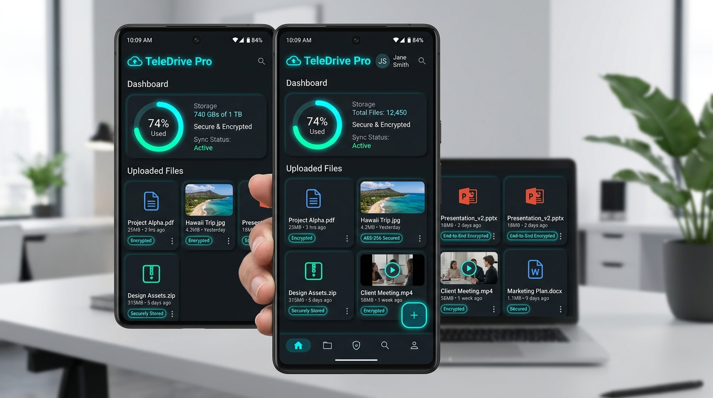
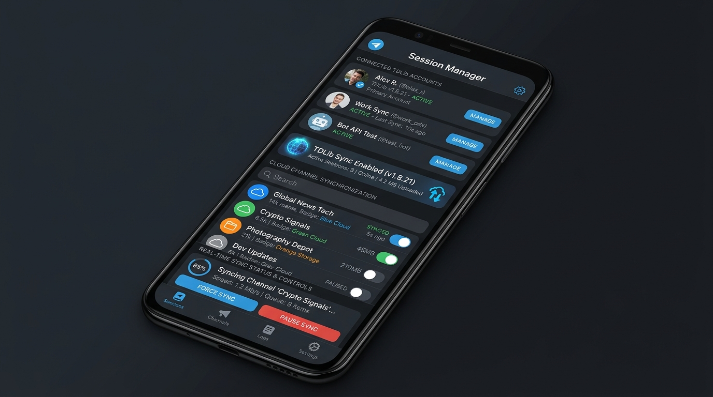
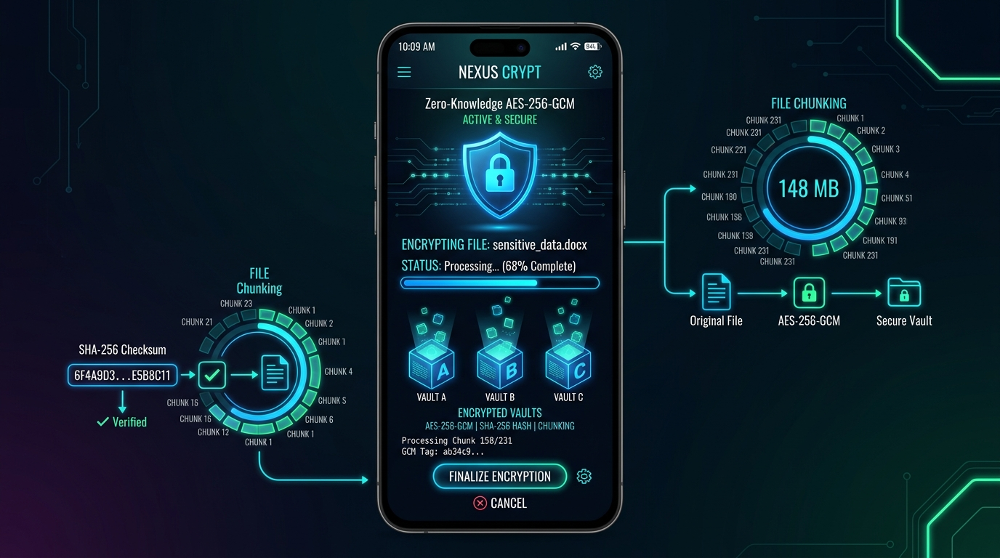
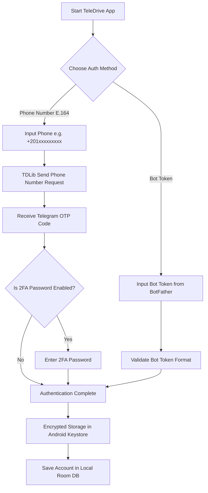
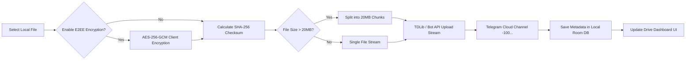
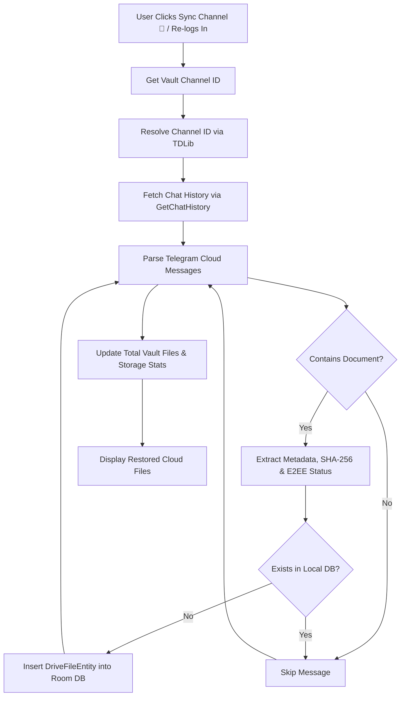
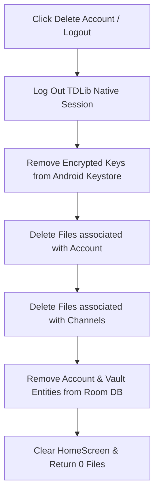

# ⚡ TeleDrive Pro - Unlimited Cloud Storage over Telegram

  

  
  
  
  
  

---

## 📖 Overview | نظرة عامة

**TeleDrive Pro** is a modern, privacy-focused, high-performance Android application that turns **Telegram Channels into an unlimited, zero-knowledge cloud drive**. 

Powered by **TDLib (Telegram Database Library)** and native **Bot API integration**, TeleDrive Pro offers client-side **AES-256-GCM encryption**, automatic **file chunking**, **MTProto proxy support**, and **real-time cloud channel synchronization**.

---

## 📸 App Interface | صور ومعاينة التطبيق

  
  

---

## ✨ Features | الميزات الرئيسية

| Feature | Description |
| :--- | :--- |
| ☁️ **Unlimited Storage** | Store unlimited files using private Telegram channels as cloud vaults. |
| 🔐 **Zero-Knowledge E2EE** | Client-side **AES-256-GCM** encryption before files leave your device. |
| 🧩 **Smart File Chunking** | Automatically splits large files into 20MB parts with SHA-256 checksum validation. |
| ⚡ **Native TDLib Engine** | Real Telegram C++ engine integration for fast MTProto network protocols. |
| 🔑 **Dual Authentication** | Support for **Phone Numbers (E.164 + OTP + 2FA)** & **Bot Tokens**. |
| 🔄 **Cloud Auto-Sync** | Instantly scan & restore your files from Telegram cloud upon re-login. |
| 🌐 **Built-in MTProto Proxy** | Switch proxies on the fly with live latency (ping) measurement. |
| 🧹 **Strict Privacy Clean** | Instant local data wiping upon account deletion or logout. |

---

## 🔄 System Architecture & Flowcharts | خرائط العمليات والدفق

### 1️⃣ Authentication & Session Flow | عملية تسجيل الدخول والجلسات

---

### 2️⃣ File Upload & Encryption Pipeline | خريطة عملية التشفير والرفع السحابي

---

### 3️⃣ Real-Time Cloud Channel Sync & Restoration | خريطة مزامنة القناة واستعادة الملفات

---

### 4️⃣ Logout & Privacy Purge Flow | خريطة مسح البيانات والخصوصية

---

## 🛠️ Technology Stack | التقنيات المستخدمة

- **Language**: 100% Kotlin
- **UI Framework**: Jetpack Compose + Material Design 3 (M3)
- **Telegram Engine**: TDLib 1.8.0 C++ Native Client (JNI)
- **Local Persistence**: Room Database + KSP
- **Asynchronous Flow**: Kotlin Coroutines & StateFlow
- **Security & Crypto**: Android Keystore + AES-256-GCM + SHA-256
- **Networking**: Retrofit 2 + OkHttp 4 for Bot API & MTProto Proxy pinging

---

## 🚀 Getting Started | كيفية الاستخدام

### 1. Connecting a Telegram Account
1. Open **TeleDrive Pro** and navigate to **Accounts (الحسابات)**.
2. Click **Connect Account (+)**.
3. Choose either **Phone Number** (enter international E.164 format e.g. `+201234567890`) or **Bot Token** (obtained from `@BotFather`).
4. Enter the verification code (OTP) or password when prompted.

### 2. Linking a Storage Vault Channel
1. Create a **Private Channel** in your Telegram app.
2. Add your account/bot as an **Administrator** with **Post Messages** permission.
3. In TeleDrive Pro, click **Add Channel (+)**, enter your channel username (e.g. `@my_vault`) or channel ID, and click Save.

### 3. Uploading & Syncing
- Tap **Upload File (رفع ملف)** from the top header or FAB to select any file.
- Tap **Sync Channel (مزامنة 🔄)** at any time or on any device to instantly pull all your stored cloud files from Telegram's servers.

---

## 📄 License | الترخيص

This project is open-source and released under the [MIT License](LICENSE).

---

  Crafted with ❤️ for Privacy and Unlimited Cloud Freedom.

